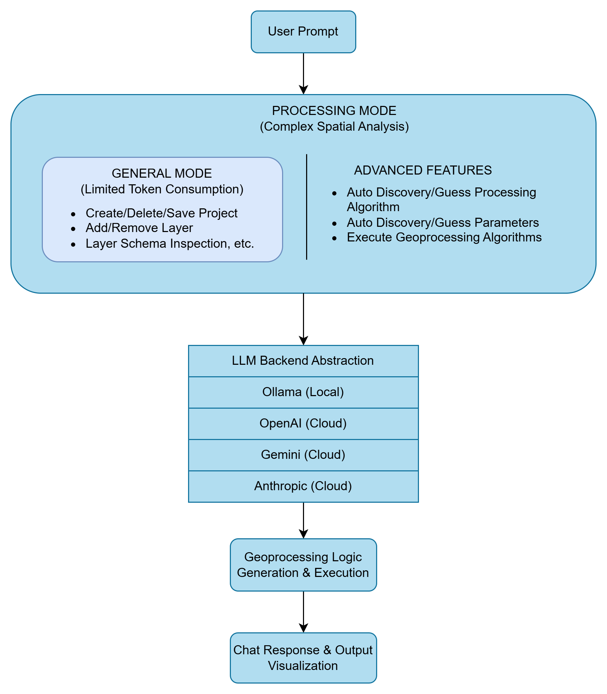
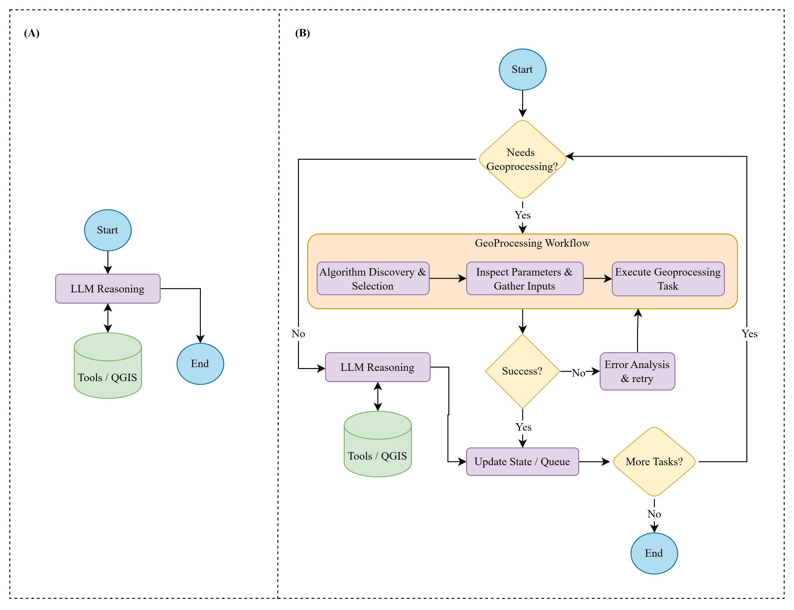

# Architecture

GeoAgent is a Python QGIS plugin built on [LangGraph](https://langchain-ai.github.io/langgraph/). Both modes are LangGraph state graphs running on a common LLM provider layer.



## Code map

| Path | Contents |
| --- | --- |
| `geo_agent.py` | The plugin class: dock widget, chat display, worker thread, model-export links, token usage logging. |
| `dialogs/` | The dock UI (`geo_agent_dialog_base.ui`) and its settings logic. |
| `agents/graph.py` | Entry points: builds the General or Processing graph and invokes it. |
| `agents/workflow.py` | Processing mode's outer loop: split into tasks, route, run, summarize. |
| `agents/geoprocessing_flow.py` | Sub-graph that runs one geoprocessing task: find, fill, check, run, retry. |
| `agents/states.py`, `agents/schemas.py` | Graph state types and the Pydantic schemas for structured LLM output. |
| `prompts/system.py` | System prompts. |
| `tools/` | LangChain tools wrapping QGIS: layer and project I/O, selection, and processing (search, parameter inspection, normalization, validation, execution). |
| `llm/` | Provider clients, the background worker thread, token usage tracking. |
| `utils/` | Layer-name matching, loading layers with QGIS's format detection (`layer_loading.py`), column descriptions for prompts and replies (`layer_columns.py`), main-thread dispatch, model export, dependency installer, Markdown rendering. |

## General mode

A conversational loop (`build_graph_app` in `agents/graph.py`): the LLM answers or calls tools, sees the tool results, and continues until it can reply (panel A below). Conversation memory is a LangGraph checkpointer keyed by the chat's thread id. Only the most recent 20 messages are sent to the model.

The selection tools (`tools/filters.py`) are thin wrappers around QGIS's own algorithms: `qgis:selectbyexpression`, `native:selectbylocation` and `native:selectwithindistance`. The LLM writes the condition as a QGIS expression; deciding which column the user meant, and whether to ask, is left to the LLM (system prompt). The tools pass parameters through the same `normalize_parameters` and `validate_parameters` as processing mode. As a result, an option like "within" maps to QGIS's own label, and an unknown column or option comes back as an error listing the valid ones.

## Processing mode



The outer workflow (`agents/workflow.py`, panel B):

1. **decompose**: one structured LLM call splits the request into tasks (`TaskDecomposition`). Each task carries an operation, an `is_geoprocessing` flag, search keywords, dependencies and stated parameters.
2. **prepare_task**: routes the task using `is_geoprocessing`. Only if the model left it out does a separate routing LLM call decide.
3. **geoprocessing** runs the task through the sub-graph below. If its result has no features and a later task depends on it, the task counts as failed, so nothing runs on an empty layer. **llm_task** handles anything else with the LLM and the QGIS tools; layers it adds become that task's outputs. If it only changed a selection and a later task depends on it, `native:saveselectedfeatures` saves the selection as a new layer, which becomes the output, since processing algorithms ignore selections. The task fails if its last round of tool calls returned errors. Both nodes record the task's result, including notes for the user, and queue its outputs as `task_N_output` labels for dependent tasks: by name for the prompts and by layer id for wiring.
4. **update_state** moves to the next task. After a failed task, the workflow stops.
5. **finalize** writes the summary shown in the chat, passing on every note and, when a task stopped for clarification, its question.

### The geoprocessing sub-graph

Each geoprocessing task runs in its own scoped state (`GeoTaskState`):

```{mermaid}
flowchart TD
    discover["discover<br/>score every registered algorithm"] --> select["select<br/>LLM picks one (shortlist, then full catalog)"]
    select --> inspect["inspect<br/>parameter definitions + help text"]
    inspect --> gather["gather<br/>LLM fills parameters; slips normalized"]
    gather -- "LLM can't tell what was meant" --> ask(["stop: ask the user"])
    gather --> check{"QGIS parameter check<br/>+ column names"}
    check -- valid --> run["run the algorithm"]
    run -- success --> done(["outputs added to the project"])
    check -- rejected --> analysis["error analysis"]
    run -- failure --> analysis
    analysis -- "bad parameter (once per algorithm)" --> gather
    analysis -- "wrong algorithm, bad data or unknown" --> select
```

- **Discovery** (`find_processing_algorithm`) scores every algorithm against the words of the task and its LLM-generated search keywords. Each word counts by how rare it is in the registry (inverse document frequency), and words in an algorithm's name or id count double. There are no stopword or synonym lists: common words count for almost nothing, and synonyms come from the keywords.
- **Normalization** (`normalize_parameters` in `tools/geoprocessing.py`) only rewrites values QGIS would reject: near-miss layer names, enum labels, parameter-name case, `task_N_output` labels. It also pins a name that matches this run's output to that output's layer id.
- **Column names** are chosen by the LLM. When an algorithm takes column names, the gather prompt lists every vector layer's columns with some of their values (`utils/layer_columns.py`). The `ParameterGathering` answer has two optional fields. `user_note` says what the LLM used in place of the user's wording; it's passed on to the summary. `clarification` holds a question when the LLM can't tell what was meant; it stops the task without retries.
- **The parameter check** (`validate_parameters`) is QGIS's own `checkParameterValues`, the same check `processing.run` performs, so it never rejects anything that would have run. It also rejects unknown column names: QGIS's check doesn't look at them, so a wrong `FIELD` would only fail when the algorithm runs, and an expression naming a missing column would "succeed" with no features. A rejection skips the LLM error analysis, names every bad value, and lists what's valid (the layer's columns, an option list's options).
- **Retries** are capped at two per task (`MAX_RETRIES`). A "bad parameter" verdict re-gathers parameters for the same algorithm once. Anything else excludes the algorithm and re-selects.

Filters that feed later steps are planned as their own `native:extractbyexpression` tasks (decomposition prompt). Their output is a real layer, so it wires to the next step and appears in the exported model.

Successful tasks store a JSON-safe record of the step (algorithm, parameters, output layer ids) in `task_results`. Model export is built from these records.

## Threading

Each request runs in a `QThread` (`llm/worker.py`) with its own asyncio loop, so QGIS stays responsive. Tools that touch the project or the map canvas (`tools/io.py`, `tools/filters.py`) are decorated with `@qgis_main_thread`: `utils/canvas_refresh.py` runs them on the main thread and waits for the result.

Slow work stays in the worker thread, with only its last step on the main thread, so QGIS doesn't freeze:

- *Add layer* reads or downloads the source in the worker thread.
- *Zoom to place* looks up the place in the worker thread.
- Processing algorithms run in the worker thread through `processing.run`.

Layers made in the worker thread belong to it, so `add_to_project` (`utils/layer_loading.py`) moves them to the main thread before adding them to the project there. QGIS's project and layer tree must only be changed from the main thread.

## Model export

After a processing request, the plugin reads the run's step records from the graph's checkpoint (`app.get_state`) and keeps them per run id. The links under the reply use the `geoagent-model:` URL scheme, handled in `GeoAgent._on_chat_link_clicked`. `utils/model_export.py` builds a `QgsProcessingModelAlgorithm` from the records:

- one child algorithm per step;
- earlier outputs wired as child outputs;
- user layers as model inputs;
- unconsumed results as model outputs.

The model can then be opened in the Model Designer or written to `.model3`.

## Token usage

`llm/usage.py` defines `TokenUsageTracker`, a LangChain callback handler. The worker passes it in the graph's run config, so every LLM call in the request reports to it, including calls inside sub-graphs and structured-output calls. When the worker finishes, the plugin logs its summary line.
